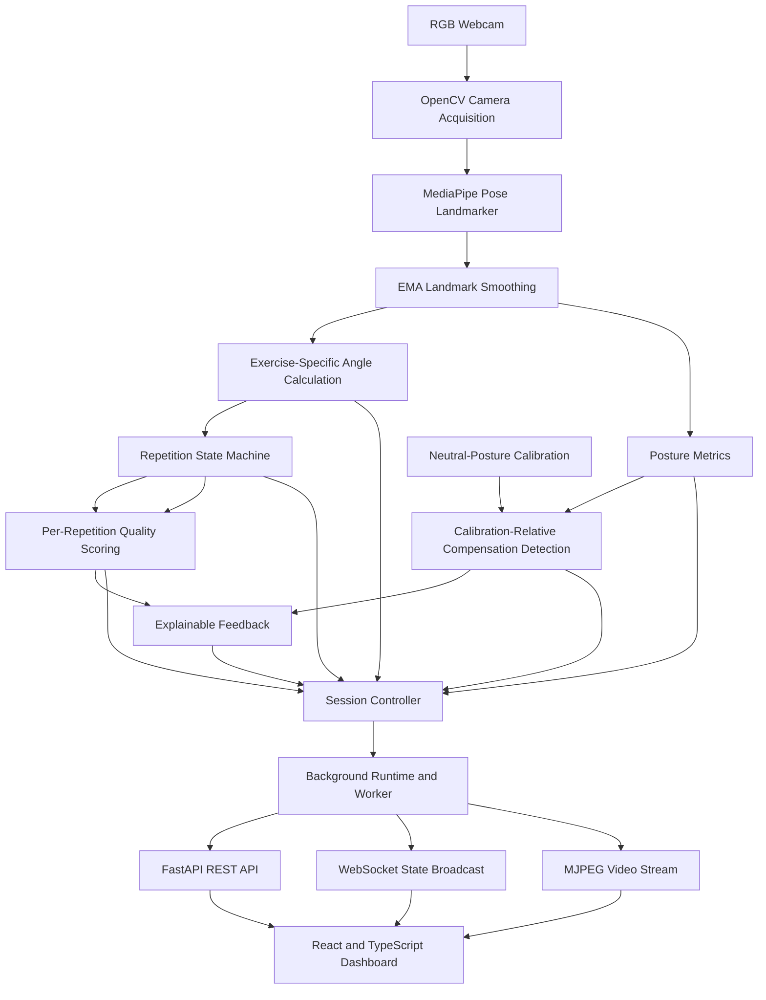

<h1 align="center">PhysioAR</h1>
AI-Assisted Markerless Physiotherapy Pose Analysis & Movement Quality Assessment

PhysioAR is a real-time, computer-vision-based physiotherapy exercise analysis prototype that tracks human body landmarks using a standard RGB webcam, calculates joint angles and posture metrics, detects selected compensatory movements, tracks exercise repetitions, and provides explainable movement feedback.

Built with Python, OpenCV, MediaPipe Pose Landmarker, FastAPI, React, TypeScript, and Vite, PhysioAR combines a modular biomechanical analysis pipeline with a responsive web dashboard and a standalone OpenCV interface.

The system is designed to explore how markerless pose estimation and deterministic movement-analysis rules can support exercise monitoring and movement-quality awareness.

> **Medical disclaimer:** PhysioAR is an engineering and research prototype. It is not a medical diagnostic device, does not guarantee anatomical accuracy, and must not replace assessment or treatment by a qualified physiotherapist or healthcare professional.

---

## Table of Contents

- [Overview](#overview)
- [Key Features](#key-features)
- [Technology Stack](#technology-stack)
- [System Architecture](#system-architecture)
- [How the Analysis Pipeline Works](#how-the-analysis-pipeline-works)
- [Supported Exercises](#supported-exercises)
- [Movement Analysis and Quality Scoring](#movement-analysis-and-quality-scoring)
- [Repository Structure](#repository-structure)
- [Prerequisites](#prerequisites)
- [Installation and Setup](#installation-and-setup)
- [Running PhysioAR](#running-physioar)
- [Web API Reference](#web-api-reference)
- [Configuration](#configuration)
- [Testing and Validation](#testing-and-validation)
- [Technical Limitations](#technical-limitations)
- [Privacy and Data Handling](#privacy-and-data-handling)
- [Troubleshooting](#troubleshooting)
- [Future Work](#future-work)
- [License](#license)

---

## Overview

Traditional exercise-monitoring applications often focus on exercise demonstrations and repetition counting. These features alone do not necessarily identify compensatory movement patterns or explain why a movement may differ from an expected pattern.

PhysioAR explores a different approach by combining markerless body-landmark estimation with geometric calculations, calibration-relative thresholds, deterministic repetition segmentation, and interpretable feedback rules.

During an exercise session, the system:

1. Captures frames from a webcam.
2. Estimates body landmarks using the MediaPipe Pose Landmarker Tasks API.
3. Smooths landmark coordinates to reduce frame-to-frame jitter.
4. Calculates exercise-specific joint angles and posture metrics.
5. Establishes a neutral-posture baseline through calibration.
6. Detects selected deviations from that baseline.
7. Tracks repetition phases using a finite-state machine.
8. Evaluates completed repetitions using movement-quality metrics.
9. Generates corrective feedback and renders a visual overlay.
10. Publishes live session data to the web dashboard through REST, WebSocket, and MJPEG streaming interfaces.

### Project objectives

- Explore real-time markerless pose analysis using a conventional webcam.
- Separate pose estimation from deterministic biomechanical calculations.
- Provide interpretable, rule-based movement feedback.
- Support multiple exercise-specific analysis pipelines.
- Build a modular backend that can operate independently of the web dashboard.
- Expose live analysis through a documented API and responsive frontend.
- Test analytical components and session lifecycle behavior independently.

---

## Key Features

### Computer Vision and Pose Estimation

- Webcam acquisition using OpenCV.
- Markerless body-landmark estimation using the MediaPipe Pose Landmarker Tasks API.
- Pre-trained pose model stored at `data/pose_landmarker_lite.task`.
- Exponential Moving Average (EMA) landmark smoothing.
- Landmark visibility checks and missing-data handling.
- Two-dimensional geometric calculations for joint angles and posture metrics.

### Exercise Analysis

- Five exercise definitions registered through a shared exercise registry.
- Exercise-specific angle calculations and repetition thresholds.
- Front-view and side-view exercise configurations.
- Neutral-posture calibration.
- Calibration-relative compensation detection.
- A deterministic five-state repetition detector.
- Per-repetition movement-quality assessment.

### Movement Feedback

- Rule-based detection of selected posture deviations.
- Explainable corrective feedback messages.
- Visual feedback through an OpenCV heads-up display.
- Live feedback and telemetry in the web dashboard.
- Tracking-loss warnings and safeguards against displaying false optimal-form confirmations.
- Calibration and session-state visibility.

### Backend and Runtime

- Modular Python analysis pipeline.
- Headless session controller.
- Dedicated background worker for camera capture and inference.
- Thread-safe session snapshots and annotated-frame access.
- FastAPI REST endpoints.
- WebSocket live-state broadcasting.
- MJPEG video streaming.
- Graceful session shutdown and runtime error reporting.

### Frontend

- React and TypeScript single-page application.
- Responsive monitoring dashboard.
- Live video feed.
- Joint-angle and repetition telemetry.
- Range-of-motion progress.
- Calibration status.
- Compensation and corrective-feedback panel.
- Per-repetition quality summaries.
- Session setup and control interface.
- WebSocket reconnection handling and lifecycle regression tests.

### Standalone Mode

The backend can also run independently through an OpenCV desktop interface:

```bash
python -m src.main
```

This mode supports an interactive video window and console telemetry without requiring the React dashboard.

### Technology Stack

| Layer | Technologies | Purpose |
| :--- | :--- | :--- |
| **Programming language** | Python | Computer vision, movement analysis, runtime and API |
| **Video acquisition** | OpenCV | Camera access, image processing, drawing and JPEG encoding |
| **Pose estimation** | MediaPipe Pose Landmarker Tasks API | Human body-landmark inference |
| **Numerical computation** | NumPy | Vector operations and numerical calculations |
| **Backend API** | FastAPI | REST endpoints and WebSocket integration |
| **API server** | Uvicorn | ASGI application serving |
| **Data validation** | Pydantic | API request and response schemas |
| **Async integration** | AnyIO | Offloading blocking operations to worker threads |
| **Frontend framework** | React | Interactive dashboard |
| **Frontend language** | TypeScript | Typed application logic and API models |
| **Development server** | Vite | Frontend development and production builds |
| **Styling** | Tailwind CSS | Responsive interface styling |
| **Frontend testing** | Vitest, Testing Library, jsdom | Component, integration and lifecycle tests |
| **Backend testing** | pytest | Unit and integration tests |

### Important Architectural Distinction

**MediaPipe** provides the pre-trained machine-learning model used for body-landmark estimation. 

The downstream **movement-analysis engine** is primarily deterministic and rule-based. Joint angles, posture deviations, repetition transitions, compensation flags, and quality scores are computed using geometric calculations and configured thresholds rather than a separately trained disease-classification model.

### System Architecture

PhysioAR separates camera acquisition, pose estimation, movement analysis, session management, API delivery, and presentation into distinct modules.



### Architectural Components

| Component | Responsibility |
| :--- | :--- |
| **Camera acquisition** | Reads image frames from the selected camera |
| **Pose estimator** | Converts frames into body-landmark predictions |
| **Landmark smoother** | Reduces coordinate jitter |
| **Geometry utilities** | Calculates angles, distances, midpoints and slopes |
| **Exercise definitions** | Define target joints, angle calculations and repetition thresholds |
| **Calibration** | Builds a neutral-posture baseline from valid observations |
| **Posture metrics** | Calculates posture measurements independently of compensation thresholds |
| **Compensation engine** | Compares current metrics against the calibrated baseline |
| **Repetition detector** | Tracks movement phases and completed repetitions |
| **Quality engine** | Calculates per-repetition ROM, alignment, stability and compensation scores |
| **Feedback generator** | Converts detected conditions into corrective messages |
| **Session controller** | Coordinates frame processing and session state |
| **Runtime** | Runs the processing loop in a dedicated worker thread |
| **FastAPI** | Exposes session controls and live analysis data |
| **React dashboard** | Displays video, telemetry, feedback and session controls |

### How the Analysis Pipeline Works

#### 1. Frame acquisition
OpenCV captures frames from a USB or integrated RGB webcam. 

* **Implementation file:** `src/acquisition.py`
* **Data format:** NumPy arrays in BGR color order.
* **Camera details:** The default camera index is `0`, though the session-start API accepts custom indices.

#### 2. Pose estimation
The pose-estimation layer converts image frames into the format required by MediaPipe and performs video-mode inference.

* **Implementation file:** `src/pose_estimation.py`
* **Model artifact:** `data/pose_landmarker_lite.task`
* **Operation:** Estimates **33 body landmarks**. Landmark coordinates and visibility information provide the inputs for downstream geometric calculations.

#### 3. Landmark smoothing
Raw landmark coordinates can fluctuate between consecutive frames. PhysioAR applies an **Exponential Moving Average (EMA)** filter to the coordinate values.

* **Implementation file:** `src/utils/smoothing.py`
* **Variables:** 
  * X<sub>t</sub> is the current coordinate.
  * S<sub>t-1</sub> is the previous smoothed coordinate.
  * S<sub>t</sub> is the updated smoothed coordinate.
  * α controls the balance between responsiveness and smoothing. The configured smoothing factor is α = 0.5.

The general EMA update formula is:

<p align="center"><b>S<sub>t</sub> = αX<sub>t</sub> + (1 - α)S<sub>t-1</sub></b></p>

> **Audit Note:** Coordinate components x, y, and z are smoothed while visibility values remain raw.

#### 4. Exercise-specific angle calculation
Each exercise defines its own angle-calculation logic and repetition thresholds.

* **Implementation directory:** `src/exercises/`
* **Calculations include:**
  * Shoulder angle relative to a vertical reference.
  * Knee interior angle using hip, knee, and ankle landmarks.
  * Elbow flexion derived from the interior shoulder-elbow-wrist angle.
  * Hip abduction relative to a vertical reference.
  * Knee angle and forward-trunk inclination for sit-to-stand.

This exercise-specific design keeps movement conventions and thresholds separate from the generic runtime.

#### 5. Neutral-posture calibration
Calibration establishes a reference posture for the current session.

* **Implementation files:** `src/calibration.py` and `src/session.py`
* **Operation:** The calibration accumulator accepts valid observations and constructs a baseline containing statistical information (mean and standard deviation) of supported posture metrics.
* **Audited configurations:**
  * Minimum of **30 valid samples** by default.
  * Landmark visibility threshold of **0.5**.
  * **Calibration duration:** Web calibration endpoint defaults to **3 seconds**, while the standalone/headless calibration workflow specifies a **10-second default**.

> **Warning:** Calibration is session-local. A poor or asymmetrical initial posture can distort subsequent baseline-relative comparisons.

#### 6. Posture metric extraction
Posture calculations are kept separate from compensation decisions. 

* **Implementation file:** `src/metrics/posture.py`
* **Extracted measurements:**
  * Torso lean
  * Neck tilt
  * Hip rotation proxy
  * Lateral trunk lean
  * Shoulder-height difference
  * Hip-height difference

Separating raw measurements from threshold evaluation makes the analysis easier to test and extend.

#### 7. Compensation detection
The generic compensation engine compares a current posture metric against the corresponding calibrated baseline.

* **Implementation file:** `src/compensation.py`
* **Variables:** 
  * x is the current metric.
  * μ is the baseline mean.
  * σ is the standard deviation.
  * F is a configured fixed threshold floor.
  * D is the current deviation from baseline.
  * T is the effective threshold.

The mathematical approach combines an individual's observed baseline variability with a fixed minimum threshold:

<p align="center"><b>D = |x - μ|</b></p>

<p align="center"><b>T = max(2σ, F)</b></p>

A compensation is flagged when:

<p align="center"><b>D &gt; T</b></p>

Generic exercise-specific checks can also be gated by repetition phase (e.g., the sit-to-stand forward-trunk check is evaluated during the rising phase).

#### 8. Repetition detection
The repetition detector tracks movement phases and identifies completed repetitions.

* **Implementation file:** `src/rep_detection.py`
* **Deterministic 5-state machine:**
  1. `WAITING_FOR_START`
  2. `DOWN`
  3. `RISING`
  4. `UP`
  5. `FALLING`

Exercise definitions provide the relevant angle thresholds. Missing angle values are handled safely without forcing a false state transition.

#### 9. Movement-quality scoring
When a repetition completes, the quality engine evaluates the relevant samples collected during that repetition.

* **Implementation file:** `src/quality.py`
* **Score components:** Range of Motion (ROM), Alignment, Stability, and Compensation. 
* **Scaling:** Normalized to a **0–100 scale**. *(See Movement Analysis and Quality Scoring for formulas).*

#### 10. Feedback generation
The feedback generator converts supported compensation results and metric deviations into human-readable messages.

* **Implementation file:** `src/feedback.py`
* **Logic:** Messages are explainable because they originate from explicit measurements and rules. The frontend prioritizes tracking and warning states over positive form confirmation. Loss of pose detection is never presented as proof of optimal form.

#### 11. Overlay rendering
The OpenCV overlay renders visual data directly onto the video frame.

* **Implementation file:** `src/overlay.py`
* **Rendered items:** Pose visualization, joint-angle information, ROM progress, and feedback banners. The annotated frame is then passed to the runtime for video streaming.

#### 12. Runtime and data delivery
A dedicated background worker performs continuous frame processing independent of individual dashboard requests.

* **Implementation files:** `src/session.py`, `src/runtime.py`, `src/api/routes.py`, `src/api/websocket.py`, and `src/api/streaming.py`
* **Interface outputs:**
  1. **REST:** Health checks and session controls.
  2. **WebSocket:** Live session snapshots and runtime errors.
  3. **MJPEG:** The annotated live video feed.

### Supported Exercises

PhysioAR currently registers five exercise definitions.

| Exercise | Identifier | Recommended Camera View | Primary Joint | ROM Target |
| :--- | :--- | :--- | :--- | :--- |
| **Shoulder Abduction** | `shoulder_abduction` | Front | Shoulder | 90° |
| **Seated Knee Extension** | `seated_knee_extension` | Side | Knee | 150° |
| **Standing Hip Abduction** | `standing_hip_abduction` | Front | Hip | 45° |
| **Elbow Flexion-Extension** | `elbow_flexion_extension` | Side | Elbow | 130° |
| **Sit to Stand** | `sit_to_stand` | Side | Knee | 90° |

The camera-view recommendation matters because the system primarily uses two-dimensional image geometry. Using an unsuitable viewing angle can distort the measurements.

### Exercise-Specific Analysis

#### Shoulder Abduction
* **Vector Tracking:** Tracks the shoulder-to-elbow vector against a vertical reference.
* **Angle Benchmarks:** Treats the arm resting by the side as approximately 0° and horizontal elevation as approximately 90°.
* **Landmarks Used:** Uses shoulder, elbow and wrist landmarks.
* **Compensations Evaluated:** Evaluates supported torso-lean, shoulder-hike and neck-tilt compensations.

#### Seated Knee Extension
* **Vector Tracking:** Calculates the interior angle formed by the hip, knee and ankle.
* **Angle Benchmarks:** Uses approximately 90° as a seated-flexion reference and approaches 180° for full extension.
* **Compensations Evaluated:** Evaluates supported torso-lean, neck-tilt, hip-rotation and lateral-trunk-lean compensations.

#### Standing Hip Abduction
* **Vector Tracking:** Measures the hip-to-knee vector against an upward vertical reference.
* **Angle Benchmarks:** Produces an angle near 0° when the leg hangs vertically.
* **Camera Setup:** Uses a front-view camera configuration.
* **Compensations Evaluated:** Evaluates lateral-trunk-lean and hip-hike checks.

#### Elbow Flexion-Extension
* **Vector Tracking:** Calculates the shoulder-elbow-wrist interior angle.
* **Camera Setup:** Uses a side-view camera configuration.
* **Compensations Evaluated:** Evaluates supported torso-lean, shoulder-hike and shoulder-substitution compensations.

The interior angle is transformed into a flexion-oriented measurement using the following formula:

<p align="center"><b>θ<sub>flexion</sub> = max(0°, 180° - θ<sub>interior</sub>)</b></p>

#### Sit to Stand
* **Vector Tracking:** Uses the hip-knee-ankle angle as the primary repetition metric.
* **Angle Benchmarks:** Uses seated and standing angle thresholds to distinguish movement phases.
* **Compensations Evaluated:** Evaluates insufficient forward-trunk inclination during the rising phase.
* **Trunk Inclination:** Uses the hip-to-shoulder vector to estimate trunk inclination.

### Important Scope Note

The audit identified hand_assisted_rising and asymmetric_weight_shift as frontend feedback-label reservations. They are not currently evaluated by the backend compensation engine and should not be interpreted as implemented detection capabilities.

### Movement Analysis and Quality Scoring

#### Compensation Rules

The following compensation checks are reported as implemented in the backend.

| Identifier | Meaning | Configured Fixed Floor |
| :--- | :--- | :--- |
| **torso_lean** | Deviation of the torso from vertical | 4° |
| **shoulder_hike** | Difference in left/right shoulder height | 1 normalized image unit |
| **neck_tilt** | Head/neck tilt relative to vertical | 4° |
| **hip_rotation** | Pelvic orientation proxy relative to horizontal | 4° |
| **lateral_trunk_lean** | Lateral trunk inclination | 4° |
| **trunk_lean** | Exercise-specific name mapped to lateral trunk deviation | 4° |
| **hip_hike** | Difference in left/right hip height | 1 normalized image unit |
| **shoulder_substitution** | Upper-arm movement used as a proxy for shoulder substitution | 4° |
| **insufficient_forward_trunk_lean** | Insufficient forward trunk inclination during sit-to-stand rising | 25° lower threshold |

The effective thresholds are not identical across all metrics. Some use baseline-relative deviation with a fixed floor, while the sit-to-stand generic check uses a phase-gated lower threshold.

#### Per-Repetition Quality Metrics

##### 1. Range-of-Motion Score
The score compares the maximum observed angle during a repetition with the exercise's configured ROM target. The audited ROM calculation is:

<p align="center"><b>Q<sub>ROM</sub> = min( max(θ) / θ<sub>target</sub> , 1 ) × 100</b></p>

##### 2. Alignment Score
Alignment is based on normalized posture deviations, using the configured alignment normalization constant of 15.0 and a shoulder-unit scaling constant of 100.0. The audited general form is:

<p align="center"><b>Q<sub>alignment</sub> = max( 0, 100 - 100R<sub>deviation</sub> )</b></p>

where R<sub>deviation</sub> is the average normalized deviation ratio computed by the implementation.

##### 3. Stability Score
Stability uses joint-angle variability within the repetition. With the configured stability normalization constant of 30°:

<p align="center"><b>Q<sub>stability</sub> = max( 0, 100 - (σ<sub>θ</sub> / 30) × 100 )</b></p>

where σ<sub>θ</sub> is the standard deviation of the relevant angle samples.

##### 4. Compensation Score
The compensation score deducts 15 points for each distinct compensation type flagged at least once during a repetition:

<p align="center"><b>Q<sub>compensation</sub> = max( 0, 100 - 15N )</b></p>

where N is the number of distinct compensation types flagged for that repetition.

##### 5. Overall Quality Index
The overall score combines the component scores using fixed weights:

<p align="center"><b>Q<sub>overall</sub> = 0.30Q<sub>ROM</sub> + 0.20Q<sub>alignment</sub> + 0.20Q<sub>stability</sub> + 0.30Q<sub>compensation</sub></b></p>

The weights prioritize ROM and compensation while retaining alignment and movement stability.

Interpretation: These are engineered heuristic scores, not clinically validated outcome measures. A high score does not establish that an exercise is safe, anatomically correct, or appropriate for a particular patient.

#### Missing-Data Handling

The implementation includes several guardrails:
* **Required landmarks** below the configured visibility threshold can cause a metric to return None.
* **Missing angle values** do not force arbitrary repetition-state transitions.
* **Compensation evaluation** is unavailable when calibration has not succeeded.
* **Lost-pose states** are surfaced in the frontend rather than being treated as optimal-form evidence.
* **The frontend** handles non-finite or missing telemetry defensively.

### Repository Structure

The following tree highlights the important source files identified during the repository audit.

```text
PhysioAR/
├── data/
│   └── pose_landmarker_lite.task
├── src/
│   ├── __init__.py
│   ├── acquisition.py
│   ├── calibration.py
│   ├── compensation.py
│   ├── config.py
│   ├── feedback.py
│   ├── main.py
│   ├── overlay.py
│   ├── pose_estimation.py
│   ├── quality.py
│   ├── rep_detection.py
│   ├── runtime.py
│   ├── session.py
│   ├── api/
│   │   ├── __init__.py
│   │   ├── app.py
│   │   ├── routes.py
│   │   ├── schemas.py
│   │   ├── streaming.py
│   │   └── websocket.py
│   ├── exercises/
│   │   ├── __init__.py
│   │   ├── base.py
│   │   ├── shoulder_abduction.py
│   │   ├── seated_knee_extension.py
│   │   ├── standing_hip_abduction.py
│   │   ├── elbow_flexion_extension.py
│   │   └── sit_to_stand.py
│   ├── metrics/
│   │   ├── __init__.py
│   │   └── posture.py
│   └── utils/
│       ├── __init__.py
│       ├── geometry.py
│       └── smoothing.py
├── tests/
│   ├── test_api.py
│   ├── test_calibration.py
│   ├── test_compensation.py
│   ├── test_debug_overlay.py
│   ├── test_elbow_flexion_extension.py
│   ├── test_exercises.py
│   ├── test_feedback.py
│   ├── test_generic_compensation.py
│   ├── test_geometry.py
│   ├── test_overlay.py
│   ├── test_posture.py
│   ├── test_quality.py
│   ├── test_rep_detection.py
│   ├── test_runtime.py
│   ├── test_seated_knee_extension.py
│   ├── test_session_controller.py
│   ├── test_sit_to_stand.py
│   ├── test_smoothing.py
│   └── test_standing_hip_abduction.py
├── frontend/
│   ├── index.html
│   ├── package.json
│   ├── postcss.config.js
│   ├── tailwind.config.js
│   ├── tsconfig.json
│   ├── tsconfig.app.json
│   ├── tsconfig.test.json
│   ├── vite.config.ts
│   └── src/
│       ├── App.tsx
│       ├── App.css
│       ├── index.css
│       ├── main.tsx
│       ├── components/
│       │   ├── common/
│       │   │   └── ErrorBoundary.tsx
│       │   ├── feedback/
│       │   │   └── FeedbackPanel.tsx
│       │   ├── layout/
│       │   │   └── Header.tsx
│       │   ├── metrics/
│       │   │   ├── MetricCards.tsx
│       │   │   └── QualitySummary.tsx
│       │   ├── session/
│       │   │   └── SessionSetup.tsx
│       │   └── video/
│       │       └── VideoFeed.tsx
│       ├── hooks/
│       │   └── useSessionWebSocket.ts
│       ├── lib/
│       │   ├── api.ts
│       │   └── utils.ts
│       ├── test/
│       │   ├── App.test.tsx
│       │   ├── components.test.tsx
│       │   ├── regression_lifecycle.test.tsx
│       │   ├── setup.ts
│       │   └── useSessionWebSocket.test.ts
│       └── types/
│           └── index.ts
├── requirements.txt
├── requirements-dev.txt
└── README.md
```

Some local configuration, generated output, virtual environments, and package-lock files are omitted from this representative tree.

#### Backend Module Responsibilities

| Module | Responsibility |
| :--- | :--- |
| **src/acquisition.py** | OpenCV camera wrapper and frame acquisition |
| **src/pose_estimation.py** | MediaPipe Tasks pose inference |
| **src/calibration.py** | Calibration baseline and validation |
| **src/config.py** | Thresholds, smoothing and quality constants |
| **src/metrics/posture.py** | Posture metric extraction |
| **src/compensation.py** | Compensation rules and generic checks |
| **src/rep_detection.py** | Five-state repetition detector |
| **src/quality.py** | Per-repetition quality evaluation |
| **src/feedback.py** | Corrective feedback generation |
| **src/overlay.py** | Annotated OpenCV video overlay |
| **src/session.py** | Headless session controller and snapshots |
| **src/runtime.py** | Background worker and thread-safe runtime |
| **src/api/app.py** | FastAPI application, CORS and lifespan |
| **src/api/routes.py** | REST endpoints |
| **src/api/schemas.py** | Pydantic request/response schemas |
| **src/api/streaming.py** | MJPEG streaming |
| **src/api/websocket.py** | WebSocket connection management and broadcasting |
| **src/main.py** | Standalone OpenCV application |

#### Frontend Module Responsibilities

| Module | Responsibility |
| :--- | :--- |
| **frontend/src/App.tsx** | Root component, dashboard layout and session lifecycle coordination |
| **components/video/VideoFeed.tsx** | Annotated video display |
| **components/feedback/FeedbackPanel.tsx** | Compensation messages, warnings and corrective guidance |
| **components/metrics/MetricCards.tsx** | Live joint-angle, repetition, ROM and calibration telemetry |
| **components/metrics/QualitySummary.tsx** | Quality score summaries |
| **components/session/SessionSetup.tsx** | Exercise selection, session controls and calibration actions |
| **components/layout/Header.tsx** | Header and status indicators |
| **components/common/ErrorBoundary.tsx** | React error boundary and fallback UI |
| **hooks/useSessionWebSocket.ts** | Live WebSocket messages and reconnect handling |
| **lib/api.ts** | REST client and API error handling |
| **types/index.ts** | TypeScript data models matching backend schemas |
| **test/** | Component, integration and lifecycle regression tests |

### Prerequisites

The audited environment used Python 3.12.3. The frontend dependency configuration targets a modern Node.js environment; verify compatibility with the installed package versions if setup fails.

You will need:
* **Python 3.12** or a compatible Python version.
* **Node.js and npm** compatible with the frontend dependencies.
* **A USB or integrated RGB webcam**.
* **Git**, if cloning the repository.
* **A supported operating system** with camera access and OpenCV support.
* **Sufficient CPU resources** for real-time video capture and pose inference.

A GPU is not established as a requirement by the audit.

#### Model Asset
The pose estimator uses:
`data/pose_landmarker_lite.task`

Ensure this file exists before starting inference. The audit identified the model artifact in the repository.

### Installation and Setup

#### 1. Clone the repository
```bash
git clone https://github.com/MD-Irfan19/PhysioAR.git
cd PhysioAR
```
If the repository is already on your machine, navigate to its root directory instead.

#### 2. Create a Python virtual environment

**Windows PowerShell**
```powershell
python -m venv venv
.\venv\Scripts\Activate.ps1
```
If PowerShell blocks activation due to the execution policy, use an appropriate local Python environment activation method for your machine.

**macOS / Linux**
```bash
python3 -m venv venv
source venv/bin/activate
```

#### 3. Install backend dependencies
From the repository root:
```bash
python -m pip install --upgrade pip
pip install -r requirements.txt
```

To install development and testing dependencies (such as `pytest` and `httpx`):
```bash
pip install -r requirements-dev.txt
```

#### 4. Install frontend dependencies
Open another terminal and navigate to the frontend directory:
```bash
cd frontend
npm install
```

### Running PhysioAR

The web application requires the backend and frontend development server to run simultaneously.

#### Option A: Run the web application

**Terminal 1 — Backend API**
From the project root, activate the Python virtual environment and run:
```bash
uvicorn src.api.app:app --host 0.0.0.0 --port 8000 --reload
```

The backend is available at:
* **API base URL:** http://localhost:8000
* **Health endpoint:** http://localhost:8000/api/health
* **Exercise registry:** http://localhost:8000/api/exercises
* **Interactive API documentation:** http://localhost:8000/docs

The interactive documentation URL is provided by FastAPI's standard documentation interface when enabled by the application.

**Terminal 2 — Frontend**
```bash
cd frontend
npm run dev
```

Open:
http://localhost:5173

The Vite development server serves the React dashboard, which communicates with the FastAPI backend.

#### Option B: Run the standalone OpenCV application

From the repository root, with the Python environment activated:
```bash
python -m src.main
```

This launches the standalone application without requiring the web dashboard. The desktop workflow uses an OpenCV window and console telemetry. It is useful for exercising the underlying analysis pipeline independently of the browser interface.

#### Typical web session workflow

1. Start the backend and frontend.
2. Open the dashboard.
3. Select one of the supported exercises.
4. Choose the relevant body side.
5. Position the camera according to the exercise's recommended view.
6. Start the session.
7. Complete the neutral-posture calibration.
8. Confirm that the subject and required landmarks are visible.
9. Perform the selected movement.
10. Observe joint-angle telemetry, repetition count, ROM progress and feedback.
11. Stop the session when finished.

The exact feedback available depends on the exercise definition and the checks implemented for it.

### Web API Reference

**Base URL:**
http://localhost:8000

The API exposes session controls through REST, live state through WebSocket, and annotated video through MJPEG.

#### REST endpoints

| Method | Endpoint | Purpose |
| :--- | :--- | :--- |
| **GET** | `/api/health` | Returns API and runtime health information |
| **GET** | `/api/exercises` | Lists registered exercises |
| **GET** | `/api/session` | Returns the current session snapshot |
| **GET** | `/api/session/status` | Returns compact session status |
| **POST** | `/api/session/start` | Starts a session |
| **POST** | `/api/session/stop` | Stops the current session |
| **POST** | `/api/session/calibrate` | Starts calibration or recalibration |

#### 1. Health check
`GET /api/health`

Example response:
```json
{
  "status": "ok",
  "runtime_running": false,
  "runtime_error": null,
  "camera_active": false,
  "version": "1.0.0"
}
```
The values shown are an example of the idle response, not a guarantee of the current runtime state.

#### 2. List supported exercises
`GET /api/exercises`

Example response:
```json
{
  "exercises": [
    {
      "id": "shoulder_abduction",
      "name": "Shoulder Abduction",
      "target_joint": "shoulder",
      "camera_orientation": "front",
      "rom_target": 90.0
    },
    {
      "id": "seated_knee_extension",
      "name": "Seated Knee Extension",
      "target_joint": "knee",
      "camera_orientation": "side",
      "rom_target": 150.0
    },
    {
      "id": "standing_hip_abduction",
      "name": "Standing Hip Abduction",
      "target_joint": "hip",
      "camera_orientation": "front",
      "rom_target": 45.0
    },
    {
      "id": "elbow_flexion_extension",
      "name": "Elbow Flexion-Extension",
      "target_joint": "elbow",
      "camera_orientation": "side",
      "rom_target": 130.0
    },
    {
      "id": "sit_to_stand",
      "name": "Sit to Stand",
      "target_joint": "knee",
      "camera_orientation": "side",
      "rom_target": 90.0
    }
  ]
}
```

#### 3. Retrieve the current session
`GET /api/session`

Returns the current full session snapshot. When there is no active session, the API returns the application's idle snapshot representation.

#### 4. Retrieve session status
`GET /api/session/status`

Example response:
```json
{
  "status": "active",
  "is_running": true,
  "exercise_name": "Shoulder Abduction",
  "exercise_id": "shoulder_abduction",
  "side": "right",
  "error": null
}
```

#### 5. Start a session
`POST /api/session/start`

**Content-Type:** `application/json`

Request body:
```json
{
  "exercise_id": "shoulder_abduction",
  "side": "right",
  "camera_index": 0
}
```

| Field | Type | Required | Description |
| :--- | :--- | :--- | :--- |
| **exercise_id** | String | Yes | Registered exercise identifier |
| **side** | String | No | left or right; defaults to right |
| **camera_index** | Integer | No | Camera device index; defaults to 0 |

Reported responses include:
* **200 OK** — session started.
* **400 Bad Request** — invalid exercise identifier or side.
* **409 Conflict** — a session is already running.
* **503 Service Unavailable** — camera initialization failed.

#### 6. Stop a session
`POST /api/session/stop`

Example response:
```json
{
  "status": "stopped",
  "message": "Session stopped successfully."
}
```
Stopping a session terminates the active processing loop and releases the camera resources through the runtime lifecycle.

#### 7. Start calibration or recalibration
`POST /api/session/calibrate`

**Content-Type:** `application/json`

Request body:
```json
{
  "duration_seconds": 3.0,
  "min_samples": 30
}
```

| Field | Type | Required | Description |
| :--- | :--- | :--- | :--- |
| **duration_seconds** | Float | No | Calibration duration; defaults to 3.0, must be greater than zero |
| **min_samples** | Integer | No | Minimum sample count; defaults to 30, must be at least one |

Example response:
```json
{
  "status": "calibrating",
  "message": "Calibration requested successfully."
}
```
A 409 Conflict response is reported when no active session is available to calibrate.

### Real-Time Streaming

#### MJPEG video stream
`GET /api/video/stream`

The video endpoint streams annotated frames using multipart Motion JPEG:
```http
Content-Type: multipart/x-mixed-replace; boundary=frame
```
Each frame is encoded as JPEG.

The stream can be displayed in an HTML image element:
```html

```
When no session is active, the stream can return a placeholder frame indicating that the application is waiting for a session.

#### WebSocket session updates
**Endpoint:** `ws://localhost:8000/ws/session`

The WebSocket sends the current snapshot when a client connects and broadcasts updated snapshots while the runtime processes frames.

##### Snapshot message
The following is a representative example of the message structure:
```json
{
  "type": "snapshot",
  "timestamp": 1729153800.123,
  "data": {
    "status": "active",
    "exercise_name": "Shoulder Abduction",
    "exercise_id": "shoulder_abduction",
    "side": "right",
    "is_calibrated": true,
    "calibration_status": "calibrated",
    "pose_detected": true,
    "current_angle": 45.2,
    "joint_angle": 45.2,
    "rep_state": "rising",
    "rep_count": 3,
    "rom_target": 90.0,
    "rom_progress": 0.502,
    "active_compensation_ids": [
      "torso_lean"
    ],
    "feedback_messages": [
      "Torso Lean = 6° — reduce torso lean to maintain shoulder isolation."
    ],
    "latest_quality": {
      "overall_score": 88.5,
      "rom_score": 95.0,
      "alignment_score": 82.0,
      "stability_score": 90.0,
      "compensation_score": 85.0
    },
    "frame_index": 421
  }
}
```

##### Error message
```json
{
  "type": "error",
  "timestamp": 1729153800.456,
  "error": "Camera read failure"
}
```
The payloads above illustrate the documented schema. Actual values depend on the active session.

### Authentication
Authentication is not implemented. The API is intended for local development and is not suitable for direct exposure to untrusted networks without additional security controls.

### CORS
The audited defaults allow the following frontend origins:
* http://localhost:5173
* http://127.0.0.1:5173
* http://localhost:3000
* http://127.0.0.1:3000

The optional `PHYSIOAR_CORS_ORIGINS` environment variable can override the allowed origins with a comma-separated list.

### Configuration

#### Environment variables

| Variable | Default | Purpose |
| :--- | :--- | :--- |
| **PHYSIOAR_CORS_ORIGINS** | Localhost development origins | Overrides the backend CORS allowlist |
| **VITE_API_BASE_URL** | http://localhost:8000 | Sets the frontend's FastAPI base URL |

To configure a different backend address, create a frontend environment file if needed:
`frontend/.env`
```text
VITE_API_BASE_URL=http://localhost:8000
```
Restart the Vite development server after changing frontend environment variables. Do not place secrets in frontend environment variables. Values exposed to a Vite-built client are not private.

#### Important analysis constants
The audited configuration includes the following values in `src/config.py`.

| Constant | Value | Purpose |
| :--- | :--- | :--- |
| **SMOOTHING_ALPHA** | 0.5 | EMA coordinate smoothing |
| **CALIBRATION_SECONDS** | 10 | Default calibration duration in the standalone/headless workflow |
| **MIN_CALIBRATION_SAMPLES** | 30 | Minimum valid calibration samples |
| **LANDMARK_VISIBILITY_THRESHOLD** | 0.5 | Minimum landmark visibility threshold |
| **TORSO_LEAN_FLOOR** | 4 | Torso-lean threshold floor, degrees |
| **SHOULDER_HIKE_FLOOR** | 1 | Shoulder-height threshold floor, normalized image units |
| **NECK_TILT_FLOOR** | 4 | Neck-tilt threshold floor, degrees |
| **HIP_ROTATION_FLOOR** | 4 | Hip-rotation threshold floor, degrees |
| **LATERAL_TRUNK_LEAN_FLOOR** | 4 | Lateral-trunk-lean threshold floor, degrees |
| **HIP_HIKE_FLOOR** | 1 | Hip-height threshold floor, normalized image units |
| **SHOULDER_SUBSTITUTION_FLOOR** | 4 | Shoulder-substitution threshold floor, degrees |
| **ALIGNMENT_NORMALIZATION_CONSTANT**| 15.0 | Alignment-score normalization |
| **STABILITY_NORMALIZATION_CONSTANT** | 30.0 | Stability-score normalization |
| **COMPENSATION_PENALTY** | 15 | Points deducted per distinct compensation type |

The exact values used by a particular check depend on its implementation. Not every compensation uses the same units or threshold logic.

### Testing and Validation

The audit reported that the following automated checks passed on the inspected repository.

#### Backend tests

Run from the project root:
```bash
python -m pytest
```

Reported audit result:

| Metric | Result |
| :--- | :--- |
| **Tests collected** | 641 |
| **Passed** | 641 |
| **Failed** | 0 |
| **Skipped / expected failures** | 0 |
| **Reported duration** | 11.42 seconds |

One Starlette-related deprecation warning was reported. 

Use `python -m pytest` rather than bare `pytest`, because the audit identified an import-path issue with the bare command in the inspected environment.

#### Frontend tests

Run from the frontend directory:
```bash
npm test
```

Reported audit result:

| Metric | Result |
| :--- | :--- |
| **Test files** | 4 |
| **Tests collected** | 62 |
| **Passed** | 62 |
| **Failed** | 0 |
| **Reported duration** | 2.01 seconds |

The reported frontend test coverage includes:
* **React application** and session flows.
* **Individual UI components**.
* **Telemetry** and feedback presentation.
* **Session lifecycle** and calibration regression behavior.
* **WebSocket message handling** and reconnection behavior.

#### Frontend production build

Run from the frontend directory:
```bash
npm run build
```

The audited build completed successfully. The configured build command runs TypeScript project compilation followed by the Vite production build.

#### Test coverage limitations

Passing automated tests does not establish full hardware or clinical validation. The audit identified areas that were not comprehensively tested end-to-end, including:
* **Physical webcam behavior** across devices.
* **Actual MediaPipe model inference** under varied lighting and occlusion.
* **Real-world inference latency** and memory behavior.
* **Complete camera-to-calibration-to-live-session workflows** on physical hardware.
* **Clinical accuracy** of compensation detection and movement-quality scores.

The results above are the audit's reported results, not a guarantee that every future revision will pass. Re-run the tests against the current working tree before relying on them.

### Technical Limitations

#### 1. Two-dimensional geometry
PhysioAR primarily calculates movement metrics using two-dimensional image coordinates. A monocular webcam does not provide the same geometric information as calibrated multi-camera motion capture or dedicated depth sensors.

Movements involving substantial motion toward or away from the camera can therefore be difficult to measure reliably.

#### 2. Camera positioning
The exercise definitions specify recommended views:
* **Front view:** Shoulder Abduction and Standing Hip Abduction.
* **Side view:** Seated Knee Extension, Elbow Flexion-Extension, and Sit to Stand.

An unsuitable camera angle can distort the planar measurements used by the analysis engine.

#### 3. Landmark visibility and occlusion
Body landmarks can become unreliable when limbs are obscured by clothing, furniture, other limbs, or the edge of the camera frame.

The implementation uses visibility thresholds and missing-data handling rather than treating unavailable measurements as zero.

#### 4. Calibration sensitivity
Compensation detection depends on the neutral-posture baseline.

If calibration is performed in a slouched, asymmetrical, or otherwise unsuitable posture, subsequent deviations may be compared against an inaccurate reference.

#### 5. Exercise-specific coverage
Each exercise has its own angle calculation and set of compensation checks. Not every compensation is supported for every exercise.

The two frontend labels `hand_assisted_rising` and `asymmetric_weight_shift` are reserved labels rather than verified backend detection capabilities.

#### 6. Heuristic scores
The ROM, alignment, stability, and compensation scores are engineered metrics. Their numerical values should not be interpreted as clinically validated measurements, diagnostic probabilities, or guaranteed indicators of exercise safety.

#### 7. No user accounts or persistent history
The audited implementation does not include:
* User authentication.
* Persistent patient profiles.
* A database-backed session history.
* Persisted calibration profiles.

Session data and calibration are maintained in memory by the running application.

### Privacy and Data Handling

According to the repository audit, camera frames are processed locally by the Python application and are not intentionally recorded to video files or uploaded to cloud storage by the implemented pipeline.

The application exposes live data through:
* The local FastAPI service.
* The MJPEG video endpoint.
* The WebSocket session endpoint.

When bound to localhost, these interfaces are available on the local machine. When the backend is bound to `0.0.0.0`, it may also be reachable from other devices on the network, depending on firewall and network configuration.

#### Security considerations:
* Authentication is not implemented.
* Do not expose the API or video stream directly to an untrusted network.
* Configure CORS appropriately for the deployment environment.
* Do not assume that network binding, browser access, or future deployment changes preserve local-only behavior automatically.
* Review any future persistence, logging, or external-service integrations before making stronger privacy guarantees.

### Troubleshooting

#### Backend fails to start
Confirm that:
* The Python virtual environment is activated.
* The backend dependencies are installed.
* The required model asset exists.
* The command is executed from the repository root.

Try running:
```bash
python -m pip install -r requirements.txt
uvicorn src.api.app:app --host 0.0.0.0 --port 8000 --reload
```

#### Frontend cannot connect to the backend
1. Confirm that the backend is running on port 8000.
2. Open http://localhost:8000/api/health.
3. Check `VITE_API_BASE_URL` in `frontend/.env`, if configured.
4. Confirm that the frontend origin is permitted by the backend CORS configuration.
5. Restart the Vite development server after changing environment variables.

#### Camera initialization fails
* Close other applications that may be using the webcam.
* Verify that the operating system has granted camera access.
* Try a different `camera_index` if multiple camera devices are available.
* Confirm that the camera works in another application.
* Review backend runtime errors for camera initialization or frame-read failures.

#### Pose is not detected reliably
* Keep the relevant body landmarks inside the camera frame.
* Use the recommended front or side camera orientation for the exercise.
* Improve lighting and reduce occlusion.
* Avoid clothing or objects that obscure important joints.
* Check that the correct model asset is available.

#### Calibration does not complete
* Keep the required landmarks visible.
* Use a stable, neutral starting posture.
* Avoid excessive movement during calibration.
* Allow enough time for the minimum number of valid samples to be collected.

#### WebSocket connection disconnects
* Confirm that the backend is still running.
* Check the browser console and backend logs.
* Verify that the WebSocket endpoint is reachable at `ws://localhost:8000/ws/session`.
* Check for backend runtime errors or unexpected session shutdowns.

#### Backend tests fail to import the source package
Run tests from the repository root with:
```bash
python -m pytest
```
The audit identified this command as the reliable test invocation for the inspected environment.

### Future Work

The following are possible extensions, not claims about current functionality:
* Persistent user profiles and session history.
* Secure authentication and authorization.
* Clinician-oriented reporting and longitudinal progress analysis.
* Expanded exercise coverage and configurable exercise protocols.
* Additional compensation checks, including validated hand-assistance and weight-shift detection.
* Improved three-dimensional movement estimation.
* Hardware and end-to-end performance testing across different camera configurations.
* Systematic validation against measurements and assessments from qualified physiotherapists.
* More reproducible dependency management and deployment configuration.

Any clinical or biomechanical extensions would require careful validation before their outputs could be relied upon in patient care.
